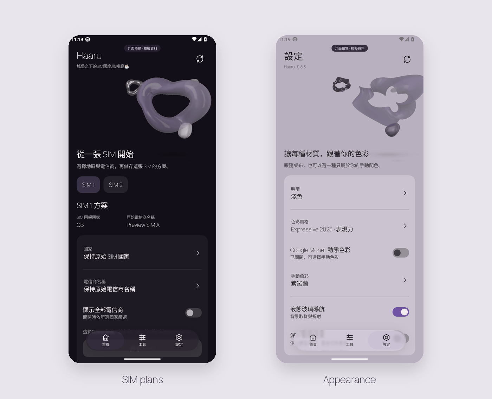

# Haaru

<strong>Change the SIM country and carrier name Android reports.</strong> A KernelSU module with per-SIM settings and restoration.

  
  
  
  

[繁體中文](README.md) · **English**

[**Download the module**](https://github.com/Cekxri/Haaru.UwU/releases) · [What it changes](#what-the-module-changes) · [Features](#features) · [Installation](#installation) · [FAQ](#faq) · [Report an issue](https://github.com/Cekxri/Haaru.UwU/issues)

城堡之下的SIM國度.咖啡廳☕

 

<picture>
  <source media="(prefers-color-scheme: dark)" srcset=".github/assets/haaru-preview-dark.png" />
  
</picture>

Interface preview from 0.8.3 · Synthetic emulator data

---

Haaru overrides SIM data in Android’s system phone service. Set a country code and carrier name for each SIM, and apps using the covered Android interfaces read those values. The two fields can be changed independently and restored when needed.

Its purpose is to remove restrictions based on SIM-region checks, such as TikTok reporting network errors after detecting a Chinese SIM.

## What the module changes

- **SIM country code** — Overrides the SIM country field in returned CarrierConfig copies, the country field in returned SubscriptionInfo copies, and the non-persistent `gsm.sim.operator.iso-country` property. Setting SIM 1 to `JP`, for example, makes the corresponding read paths report `jp` for that card.
- **Carrier name** — Overrides the CarrierConfig name and override flag, the carrier/display name in SubscriptionInfo copies, and the non-persistent `gsm.sim.operator.alpha` property. Country and name are independent settings.
- **Per-SIM application and restoration** — Saved plans follow SIM identity and map to current subscriptions and slots. The engine keeps originals, tracks natural system updates and removes overrides when restoring. Unselected cards and fields retain their original values.

> [!NOTE]
> This is a preview release. Application, restoration and compatibility with individual services on physical devices remain unverified.

## Features

### SIM plans

- **A plan for each card** — Uses the slots and subscriptions Android exposes, with separate country and name settings.
- **Presets and custom names** — 28 countries, 74 carrier presets and independent country/name choices.
- **Reapply, restore and clear** — Stop an override while keeping the plan for later.
- **Engine status** — Shows plan storage, engine initialisation and application results separately.

### Native interface

- **Miuix and liquid glass** — Native controls and a navigation dock that samples and refracts its background.
- **3D scene** — GLES organic meshes, metal and glass materials, floating motion, touch springs and scroll parallax.
- **Colour options** — Google Monet, 15 manual palettes, HSV/custom colour codes and five colour styles.
- **Reduced motion** — Follows the system's animation removal setting, with an additional App preference.

## Installation

### Requirements

- **Android 10 or later**, with **KernelSU** installed.
- A **Zygisk API 4 provider**, such as [Zygisk Next](https://github.com/Dr-TSNG/ZygiskNext), installed separately.
- System phone services and ART that support the required hook interfaces.

The module includes arm64-v8a, armeabi-v7a, x86_64 and x86 builds. Monet requires Android 12 or later; glass effects adapt to the system's capabilities.

### Download and get started

1. Download `Haaru-<version>.zip` from [Releases](https://github.com/Cekxri/Haaru.UwU/releases).
2. Install the ZIP from KernelSU's module page, then reboot your phone.
3. Open Haaru from your launcher or the module action button in KernelSU.
4. Select a SIM, choose its country and carrier name, then save and check the application status.

The module ZIP includes its matching signed app. Installation runs automatically, or finishes after boot if Android is not ready. The app sends operations to the module service and needs no separate Root grant.

| Release file | Purpose |
| :--- | :--- |
| `Haaru-<version>.zip` | The KernelSU module, including its companion App. |
| `Haaru-<version>.apk` | The companion app, used with the module. |
| `Haaru-<version>-source.zip` | The source snapshot for that release. |
| `SHA256SUMS.txt` | SHA-256 checksums for the downloads. |

### Update and remove

**Update:** install the newer module ZIP and reboot your phone. Existing SIM plans and appearance preferences are preserved.

**Remove:** uninstall the module in KernelSU and reboot your phone to clear the in-memory overrides. The companion app can be uninstalled separately.

## How it works

1. **Save the plan** — The app sends operations through a local socket. The module service verifies the peer UID, app package and signing identity.
2. **Apply the overrides** — Zygisk loads the engine into the system phone process. LSPlant hooks CarrierConfig and subscription-data readers. The engine modifies returned copies and the two non-persistent properties, checking the SIM mapping and property readback.
3. **Read and restore** — Apps using those interfaces receive the chosen values. The engine keeps originals and tracks system updates, then removes the overrides when restoring.

The physical SIM, APN, eSIM/Subscription database, MCC/MNC, IP address, GPS and account data are unchanged. A service may also check IP or account regions; those need to be handled according to that service’s requirements.

Preferences live in the local module folder, with no telemetry. SELinux mode is unchanged; the module adds scoped permissions for the phone engine’s socket.

### Use cases

- **TikTok and similar services** — Address SIM-country checks that trigger network errors or access restrictions by reporting the selected supported country.
- **Other SIM-region checks** — Similar cases, including Samsung Health’s initial SIM check, are compatibility-testing targets.
- **SIM-data identification** — Adjust the reported country or carrier name so Apps reading those fields use the chosen values.

## FAQ

<strong>What is the difference between the APK and the module?</strong>

The APK provides the interface; the module includes the phone engine and local service. Install the module ZIP and reboot your phone. The companion app is installed automatically.

<strong>Why is my saved plan still shown as inactive?</strong>

The phone engine applies the plan after it is saved. If the engine has not initialised or reports an error, the tools page shows the reason. Reboot your phone after updating the module.

<strong>What is the difference between restore and clear?</strong>

Restore stops the overrides and keeps the saved plans so they can be reapplied. Clear restores the original values and deletes the SIM plans; appearance preferences are retained.

<strong>How does Haaru differ from Nrfr?</strong>

Nrfr applies settings through Android’s CarrierConfig override interface. Haaru uses KernelSU and Zygisk to modify copies returned by phone-service readers and update non-persistent system properties. Both adjust the SIM region a service reads.

<strong>What should an engine error report include?</strong>

Include the Haaru and Android versions, Zygisk provider and version, reproduction steps, and the tools page’s de-identified diagnostic export. Before reporting, check that the app and module versions match and that you rebooted after updating.

Bugreports and module data may contain device or SIM information. Remove personal data before sharing.

## Development and contributing

Haaru uses Kotlin/Compose for its native interface, Java for Android services and reflection, Rust for data validation and migration, and C++ to connect Zygisk, ART and LSPlant.

See [RELEASE](RELEASE.md#最終建置與驗證) for the build process and [UI_BUILD](UI_BUILD.md) for the interface, colours and 3D rendering.

Submit bugs and suggestions in [Issues](https://github.com/Cekxri/Haaru.UwU/issues), or code changes through [Pull requests](https://github.com/Cekxri/Haaru.UwU/pulls). Phone-service or hook changes should include the test environment, results and restoration checks.

## Licence and acknowledgements

Haaru is maintained by [Cekxri](https://github.com/Cekxri) and licensed under the [Apache License 2.0](LICENSE). Third-party code and assets retain their own licences; see [NOTICE](NOTICE) for the full attribution.

Thanks to [Nrfr](https://github.com/a5533348/Nrfr) for its features and country/carrier presets, and [tiktok-region-hook](https://github.com/kjqg-cn/tiktok-region-hook) for research references.

The interface and engine build on [Miuix](https://github.com/compose-miuix-ui/miuix), [AndroidLiquidGlass/Backdrop](https://github.com/Kyant0/AndroidLiquidGlass), [MaterialKolor](https://github.com/jordond/materialkolor), [LSPlant](https://github.com/LSPosed/LSPlant) and other open-source projects.

 

[Downloads](https://github.com/Cekxri/Haaru.UwU/releases) · [Source](https://github.com/Cekxri/Haaru.UwU) · [Report an issue](https://github.com/Cekxri/Haaru.UwU/issues) · [繁體中文](README.md)

