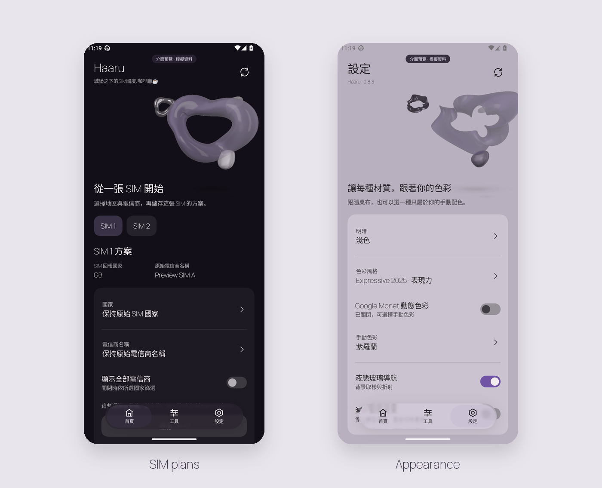

# Haaru

<strong>在系統電話服務層覆寫 SIM 國家與電信商名稱。</strong> 原創 KernelSU 模組，讓 App 讀取你設定的 SIM 回報值。

  
  
  
  

**繁體中文** · [English](README.en.md)

[**下載模組**](https://github.com/Cekxri/Haaru.UwU/releases) · [修改範圍](#模組實際修改什麼) · [功能](#功能) · [安裝](#安裝) · [常見問題](#常見問題) · [問題回報](https://github.com/Cekxri/Haaru.UwU/issues)

城堡之下的SIM國度.咖啡廳☕

 

<picture>
  <source media="(prefers-color-scheme: dark)" srcset=".github/assets/haaru-preview-dark.png" />
  
</picture>

0.8.3 原生介面預覽 · 模擬器合成資料，並非真機生效證據

---

Haaru 是一個 **在系統電話服務層覆寫 SIM 回報資料的 KernelSU 模組**。你為每張 SIM 設定國家碼與電信商名稱，電話引擎在系統對外提供這些資料時套用設定，讓讀取對應 Android 介面的 App 取得覆寫值。國家碼與名稱可以獨立設定，也可以停止覆寫、還原原值。

它以不同於 Nrfr 的架構實現相同用途：改變服務讀到的 SIM 歸屬地，用來解除依 SIM 地區檢測的使用限制。TikTok 因中國 SIM 歸屬地檢測提示網路錯誤，是本專案要解決的典型情境。

## 模組實際修改什麼

- **SIM 國家碼** — 覆寫 CarrierConfig 回傳副本中的 SIM 國家欄位、SubscriptionInfo 回傳副本的國家欄位，以及 `gsm.sim.operator.iso-country` 非持久屬性。例如為 SIM 1 設定 `JP`，對應讀取路徑便以 `jp` 回報該卡國家。
- **電信商名稱** — 覆寫 CarrierConfig 的名稱與覆寫旗標、SubscriptionInfo 副本的電信商／顯示名稱，以及 `gsm.sim.operator.alpha` 非持久屬性。名稱不會自動替你更換國家碼。
- **逐卡套用與原值還原** — 方案依 SIM 身分保存，再映射到目前的訂閱與插槽；引擎保留原值、追蹤系統自然更新，還原時撤下覆寫。未選擇的卡與欄位保留原值。

這些修改由 **系統電話程序中的 Zygisk／LSPlant 引擎**執行，原生 App 負責選擇、保存方案及顯示狀態。介面不是只改自己的文字；模組的作用位置是其他 App 讀取 SIM 資料的系統回應與屬性。

Haaru 從 **28 個國家、74 個電信商預設值**提供選擇，也支援自訂名稱。原生介面採用 Miuix、液態玻璃導航、程序化 3D 與動態配色。

> [!NOTE]
> Haaru 目前為公開測試版。上述是目前原始碼的修改機制；完整 KernelSU 真機套用、還原與個別服務效果仍待驗證。Android 10 是安裝底線，不代表所有 ROM 都已相容。

## 功能

### SIM 方案

- **每張卡各自保存** — 依系統提供的插槽與訂閱資料顯示 SIM，分別保存國家和名稱。
- **預設與自訂** — 28 國、74 個電信商預設值；國家與名稱獨立選擇。
- **重新套用、還原、清除** — 停止覆寫時可以保留方案，之後再套用。
- **確認實際狀態** — 已儲存不等於已生效；完整掛鉤與新鮮引擎回報是不同檢查。

### 原生介面

- **Miuix 與液態玻璃** — 原生控件、背景取樣與折射的導航底欄。
- **真正的 3D 場景** — GLES 有機網格、金屬與玻璃材質、漂浮、觸摸彈簧與滾動視差。
- **你的配色** — Google Monet、15 種手動色、HSV／自訂色碼及五種色彩風格。
- **動態可以減少** — 遵循系統移除動畫設定，也可在 App 裡調整。

## 安裝

### 需要什麼

- **Android 10 或更新版本**，以及已安裝的 **KernelSU**。
- 正常工作的 **Zygisk API 4 提供程式**，例如 [Zygisk Next](https://github.com/Dr-TSNG/ZygiskNext)。KernelSU 本身不提供 Zygisk。
- 系統電話服務、ART 與必要掛鉤介面可用。Haaru 依實際介面探測，不使用機型白名單。

模組提供 arm64-v8a、armeabi-v7a、x86_64 和 x86 四種架構。Monet 動態取色需要 Android 12 以上；玻璃效果依系統能力降級。

### 下載與開始使用

1. 在 [Releases](https://github.com/Cekxri/Haaru.UwU/releases) 下載 `Haaru-<版本>.zip`。
2. 在 KernelSU 的模組頁從檔案安裝 ZIP，然後**完整重新開機**。
3. 從桌面，或 KernelSU 模組的執行按鈕開啟 Haaru。
4. 選擇 SIM、國家及電信商名稱，儲存方案，再查看引擎確認結果。

**ZIP 已附同版本的簽署 App。** 安裝器會自動安裝；Android 尚未就緒時，在開機後續裝。App 不需另授予 Root，安裝也不會另外下載不同版本的 APK。

| Release 檔案 | 用途 |
| :--- | :--- |
| `Haaru-<版本>.zip` | 在 KernelSU 安裝的模組，內附配套 App。 |
| `Haaru-<版本>.apk` | 同版本的獨立 App；單獨安裝不會提供模組引擎。 |
| `Haaru-<版本>-source.zip` | 該版本的來源快照。 |
| `SHA256SUMS.txt` | 下載檔案的 SHA-256 校驗值。 |

### 更新與移除

**更新：** 直接安裝新版模組 ZIP，完整重啟。配套 App 使用相同簽章更新，既有 SIM 方案與外觀設定會保留；早期設定由遷移流程處理。

**移除：** 在 KernelSU 移除模組後完整重啟，讓電話程序重新啟動並清除記憶體中的覆寫。介面 App 可另外解除安裝。

## 如何運作

1. **App 保存方案** — 原生 App 透過受限本機 socket 把操作交給模組服務；服務核對連線 UID、App 套件與簽章。App 本身不呼叫 `su`。
2. **電話引擎套用覆寫** — Zygisk 把引擎載入系統電話程序，LSPlant 掛鉤 CarrierConfig 與訂閱資料讀取方法。引擎修改回傳副本及上述兩項非持久屬性，並核對原值、SIM 映射和覆寫後的回讀。
3. **App 讀取設定值** — 經已覆蓋介面讀取 SIM 國家／名稱的 App 取得設定值，這是影響服務 SIM 地區判定的介入點。已儲存方案、引擎確認與實際服務解除限制是不同驗證結果。

實體 SIM、APN、eSIM／Subscription 資料庫及 MCC/MNC 不在修改範圍內。IP、GPS、帳號等也不是這個模組的修改項目；服務若另外使用它們判斷地區，需要分別處理，這不否定 SIM 地區覆寫的用途。

設定保存在本機模組資料夾，Haaru 沒有遙測。模組沿用系統的 SELinux 模式；Enforcing 不會被關閉，現有規則只補上電話引擎 socket 所需的限定權限。

### 使用情境

- **TikTok 與同類服務** — 針對 SIM 國家檢測造成的網路錯誤或使用限制，回報使用者選擇的受支援國家。
- **其他依 SIM 地區檢查的服務** — 對齊 Nrfr 的同類用途，例如 Samsung Health 首次 SIM 地區檢查；個別服務仍需實測相容性。
- **SIM 資料識別不符** — 調整對外回報的國家或電信商名稱，讓讀取這些欄位的 App 使用設定值。

## 常見問題

<strong>為什麼只裝 APK 不能使用？</strong>

APK 是介面。實際電話引擎與受驗證的本機服務由 KernelSU 模組提供，需要安裝模組 ZIP 並完整重啟。

<strong>「已儲存」為什麼不代表「已生效」？</strong>

儲存只確認方案已寫入。生效還需要電話引擎初始化、必要掛鉤完整，以及與目前方案一致的有效回報。引擎未就緒時，到工具頁查看詳細狀態。

<strong>還原與清除有什麼差別？</strong>

還原停止覆寫並保留已存方案，之後可重新套用。清除會還原並刪除 SIM 方案；外觀設定保留。

<strong>Haaru 與 Nrfr 的差別是什麼？</strong>

用途對齊 Nrfr：調整服務讀到的 SIM 歸屬地，解除由 SIM 地區檢測造成的限制。Haaru 使用 KernelSU、Zygisk 與系統電話服務回傳副本／非持久屬性覆寫，並提供獨立的原生介面、逐卡方案與引擎確認；不是直接移植 Nrfr 的實作。

<strong>遇到引擎錯誤，回報哪些資料？</strong>

先確認模組與 App 版本相符，更新後已完整重啟。回報版本、Android 版本、Zygisk 提供程式與版本、重現步驟，以及工具頁的「複製去識別診斷」。

完整 Bugreport 及模組資料可能包含裝置或 SIM 資訊，請先檢查並移除個人資料，勿直接貼到公開 Issue。

## 開發與貢獻

Haaru 使用 Kotlin／Compose 建立原生介面，Java 處理 Android 服務及反射介面，Rust 提供資料驗證與遷移，C++ 連接 Zygisk、ART 與 LSPlant。

從 [Release 建置說明](RELEASE.md#最終建置與驗證)開始；[原生介面建置](UI_BUILD.md)涵蓋工具鏈、配色、3D 渲染及效能驗證界線。公開來源不含私人簽章金鑰、裝置紀錄或執行期設定。

歡迎透過 [Issues](https://github.com/Cekxri/Haaru.UwU/issues) 回報可重現的問題或提出功能建議，也歡迎提交 [Pull request](https://github.com/Cekxri/Haaru.UwU/pulls)。涉及電話服務或掛鉤的修改，請說明測試環境、驗證範圍與還原行為。

## 授權與鳴謝

Haaru 由 [Cekxri](https://github.com/Cekxri) 維護，使用 [Apache License 2.0](LICENSE)。第三方程式碼與資產保留各自授權，完整資訊見 [NOTICE](NOTICE)。

專案起於研究 [tiktok-region-hook](https://github.com/kjqg-cn/tiktok-region-hook) 與 [Nrfr](https://github.com/a5533348/Nrfr)，之後以不同架構發展為 Haaru。Nrfr 的功能與選擇資料來源照實保留鳴謝。

介面與引擎建立在 [Miuix](https://github.com/compose-miuix-ui/miuix)、[AndroidLiquidGlass／Backdrop](https://github.com/Kyant0/AndroidLiquidGlass)、[MaterialKolor](https://github.com/jordond/materialkolor)、[LSPlant](https://github.com/LSPosed/LSPlant) 與其他開源專案之上。

 

[下載](https://github.com/Cekxri/Haaru.UwU/releases) · [源碼](https://github.com/Cekxri/Haaru.UwU) · [回報問題](https://github.com/Cekxri/Haaru.UwU/issues) · [English](README.en.md)

